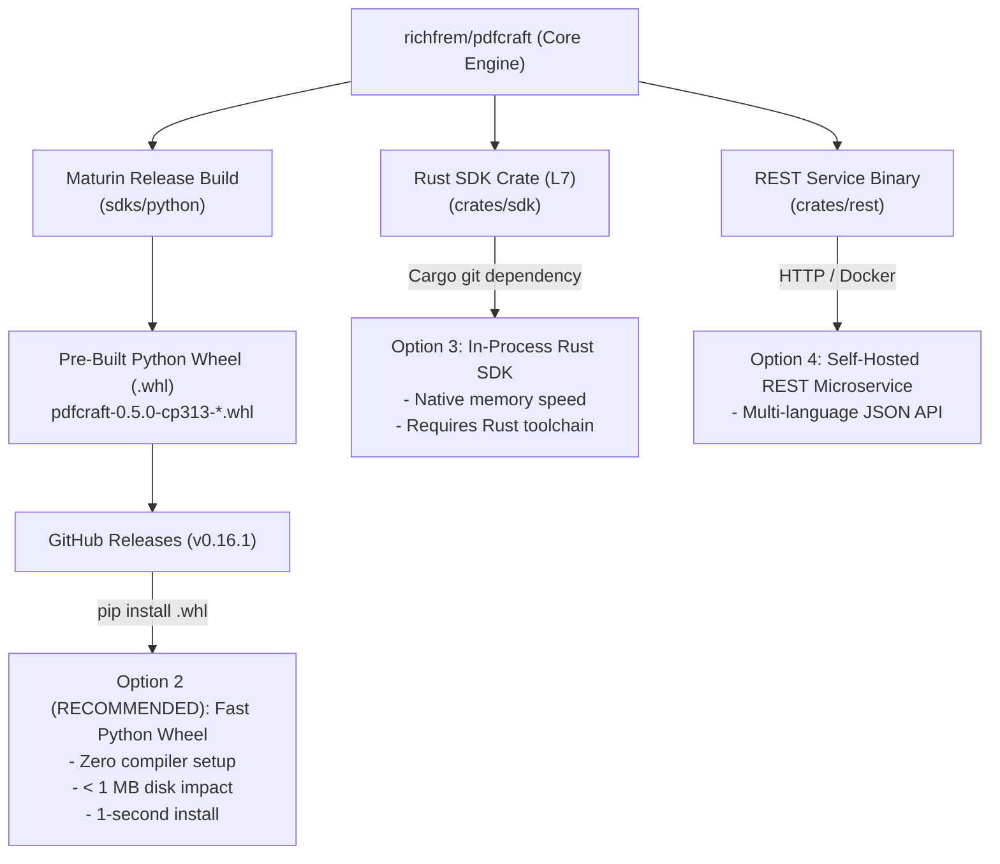

# Publishing & Consuming the PdfCraft SDK

This guide explains how to build, publish, and consume binary releases of the **PdfCraft Document Processing SDK** across downstream applications, microservices, and automation pipelines.

---

## 🎯 Architecture & Distribution Goals

The PdfCraft SDK is engineered as a unified, headless document processing foundation. Downstream consumers should never be forced to compile the entire 40+ crate Rust workspace if they only need Python bindings or HTTP endpoints.



---

## 📦 How to Create a GitHub Release with the Python SDK Wheel

### Step 1: Install Maturin
Maturin is the official PEP 517 build tool for Rust-based Python extensions.
```bash
pip install maturin
```

### Step 2: Build the Release Wheel (.whl)
Run the build inside `sdks/python`:
```bash
cd sdks/python
maturin build --release --out ../../target/wheels
```
This generates self-contained wheel packages in `target/wheels/`, for example:
* **macOS (Apple Silicon):** `pdfcraft-0.5.0-cp313-cp313-macosx_11_0_arm64.whl`
* **Linux (x86_64):** `pdfcraft-0.5.0-cp313-cp313-manylinux_2_34_x86_64.whl`
* **Windows (x64):** `pdfcraft-0.5.0-cp313-cp313-win_amd64.whl`

> **CI builds the Windows and macOS wheels for you.** The `Python wheels` workflow
> (`.github/workflows/python-wheels.yml`) builds `win_amd64` (Python 3.12 and 3.13) and
> `macosx arm64` wheels, installs each into a clean venv and merges two PDFs through the native
> engine. Run it from the Actions tab with `release_tag` set (for example `v0.16.1`) to attach the
> wheels and their `.sha256` files to that release; leave it empty to only build and get artifacts.
> Consumers that bundle the wheel (for example a Windows installer) should pin the URL and SHA-256.

### Step 3: Create GitHub Tag & Release via GitHub CLI (`gh`)
Publish the release and attach the pre-built wheel directly:
```bash
# Tag and create release in the fork
gh release create v0.16.1 target/wheels/*.whl \
  --repo richfrem/pdfcraft \
  --title "v0.16.1: Unified Document Processing SDK & Python Wheels" \
  --notes "Official release of the PdfCraft SDK featuring native PyO3 Python bindings, REST client, and pre-built wheels."
```

*(Alternatively, you can create the release via the GitHub Web UI at `https://github.com/richfrem/pdfcraft/releases/new` and drag-and-drop the files from `target/wheels/`).*

---

## 🚀 Downstream Consumer Guide: How to Use the SDK

Downstream applications can consume PdfCraft through any of the following 4 options:

### 🌟 Option 2: Pre-Built Python Wheel (.whl) — RECOMMENDED
This is the recommended path for Python projects, AI Agent skills (e.g. APM skills), and rapid prototyping.

#### Why it's recommended:
* **Instant Installation:** Takes less than 2 seconds via `pip`.
* **Zero Compilation:** No Rust toolchain, Cargo, or C compiler required on client machines.
* **Tiny Disk Footprint:** Requires under 10 MB compared to 2–4 GB for Cargo compilation caches.

#### How to install in downstream repositories:
1. **Direct installation via pip:**
   ```bash
   pip install "https://github.com/richfrem/pdfcraft/releases/download/v0.16.1/pdfcraft-0.5.0-cp313-cp313-macosx_11_0_arm64.whl"
   ```
2. **In downstream `requirements.txt`:**
   ```text
   # Direct pinned release wheel from GitHub
   https://github.com/richfrem/pdfcraft/releases/download/v0.16.1/pdfcraft-0.5.0-cp313-cp313-macosx_11_0_arm64.whl
   ```
3. **Usage in Python code:**
   ```python
   import pdfcraft

   # Call native PdfCraft document processing routines
   client = pdfcraft.LocalClient()
   # Render or process documents directly in memory
   ```

---

### Option 1: Local / Monorepo Development
When developing downstream tools side-by-side on the same workstation:
```bash
# Install directly from the local sibling directory into your virtualenv
pip install ../pdfcraft/sdks/python
```
*(Maturin will compile the local source in development mode).*

---

### Option 3: Native Rust SDK (`pdfcraft-sdk`)
For high-performance Rust applications, link directly against the L7 SDK crate:

Add to downstream `Cargo.toml`:
```toml
[dependencies]
pdfcraft-sdk = { git = "https://github.com/richfrem/pdfcraft", branch = "main" }
tokio = { version = "1", features = ["macros", "rt-multi-thread"] }

# Optional local path override when developing locally:
[patch."https://github.com/richfrem/pdfcraft"]
pdfcraft-sdk = { path = "../pdfcraft/crates/sdk" }
```

In Rust code (`src/main.rs`):
```rust
use pdfcraft_sdk::{DocumentSource, LocalClient, PdfCraftClient, RenderOptions};

#[tokio::main]
async fn main() -> Result<(), Box<dyn std::error::Error>> {
    let client = LocalClient::default();
    let src = DocumentSource::from_file("document.pdf");
    let page1 = client.render_page(&src, 1, RenderOptions::default())?;
    println!("Rendered page successfully: {:?}", page1);
    Ok(())
}
```

---

### Option 4: Self-Hosted REST Microservice (`pdfcraft-rest`)
For distributed environments, Docker containers, or polyglot stacks (Go, Java, C#, PHP):

1. **Launch the REST service:**
   ```bash
   cargo run -p pdfcraft-rest -- --port 8080 --host 0.0.0.0
   ```
2. **Interact via standard HTTP / OpenAPI:**
   * Health: `GET http://localhost:8080/health`
   * OpenAPI Specification: `GET http://localhost:8080/openapi.json`
   * TypeScript Client: `npm install @pdfcraft/sdk`
   * Python REST Client: `pdfcraft.RestClient(endpoint="http://localhost:8080")`

---

## 🔒 Upstream Preservation Invariant
Per `AGENTS.md` §6, the SDK (`crates/sdk`), REST service (`crates/rest`), Python bindings (`sdks/python`), and TypeScript SDK (`sdks/typescript`) are **protected fork extensions**. When syncing with `upstream/main`, these files and workspace registrations are permanently preserved.
